# Manual de usuario del panel

Salud y Bienestar · Proyecto 2 · ITCA-FEPADE

Versión de la implementación revisada el 14 de noviembre de 2026. Capturas de un entorno local con datos ficticios.

## Alcance y permisos

Este manual cubre todas las pantallas actualmente accesibles de los módulos 1 y 3. Los módulos de actividad, entrenamientos, foro, consejos y dashboard deberán incorporarse cuando los otros miembros entreguen sus pantallas.

Administrador: consulta el panel, gestiona usuarios y alimentos y descarga reportes. Moderador: consulta usuarios, objetivos, recordatorios, alimentos y comidas. Usuario: accede mediante la aplicación móvil/API.

## 1. Acceder al panel

Abre la dirección del panel y escribe tu correo y contraseña. Pulsa Iniciar sesión. La opción Recordarme conserva el acceso en el navegador; úsala únicamente en un equipo personal.

Solo administradores y moderadores entran al panel. Una cuenta con rol usuario utiliza la aplicación móvil y no puede acceder a estas pantallas.

Si no recuerdas tu contraseña, selecciona ¿Olvidaste tu contraseña?, escribe tu correo y pulsa Enviar enlace de recuperación. En desarrollo, el correo se guarda en el registro de la aplicación cuando el envío está configurado como log.

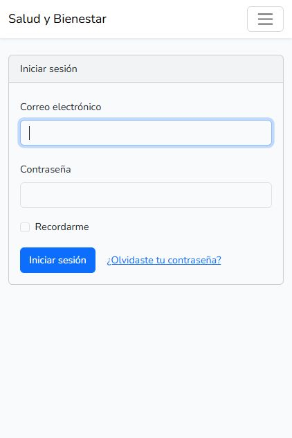

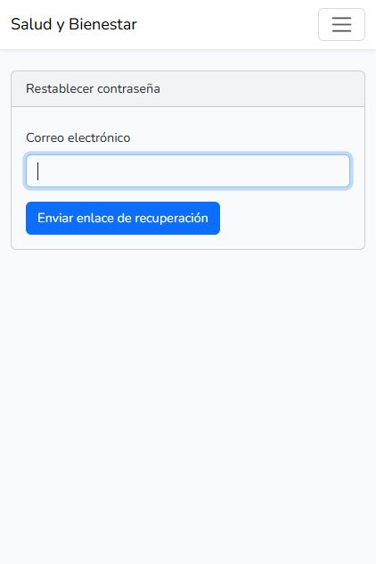

## 2. Recuperación y confirmación de contraseña

Abre el enlace recibido por correo, comprueba la dirección y escribe la nueva contraseña dos veces. Pulsa Restablecer contraseña. La captura del formulario usa un enlace de demostración; no permite recuperar ninguna cuenta real.

La pantalla Confirmar contraseña puede solicitar tu clave actual antes de continuar con una acción protegida. Es distinta de la recuperación: aquí no se crea una contraseña nueva.

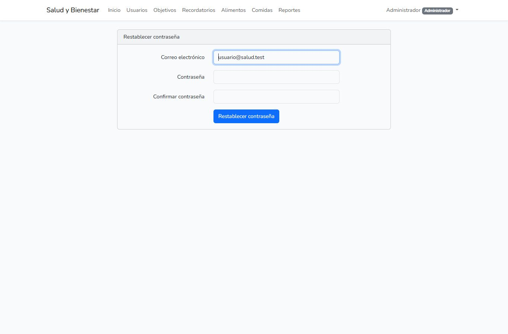

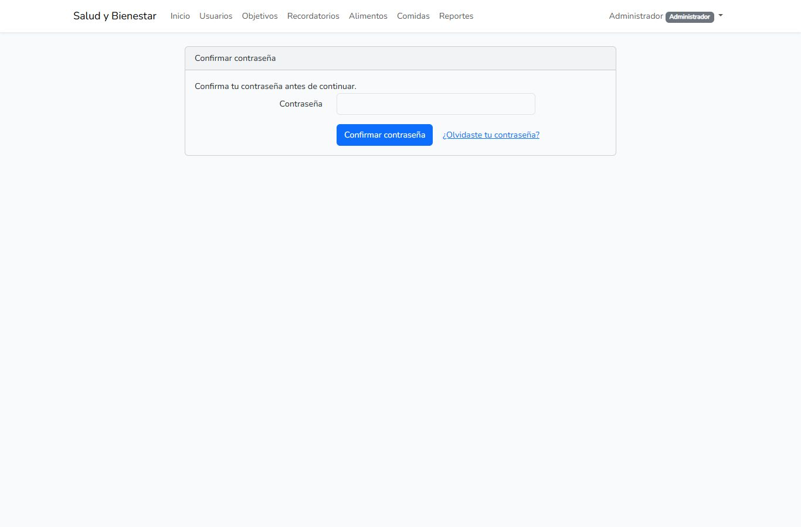

## 3. Inicio y navegación

Al iniciar sesión se muestra el nombre de la cuenta y su rol. Usa el menú para abrir Usuarios, Objetivos, Recordatorios, Alimentos o Comidas. Reportes aparece para administradores.

En pantallas pequeñas, pulsa el botón de tres líneas para desplegar el menú. Para salir, abre el menú de tu nombre y selecciona Cerrar sesión. El inicio actual contiene el acceso a Usuarios; el dashboard general corresponde a una integración posterior.

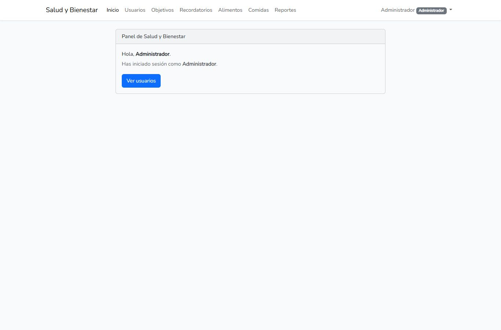

## 4. Consultar y filtrar usuarios

En Usuarios, busca por nombre o correo y selecciona un rol o estado. Pulsa Filtrar. El botón × quita los filtros. La tabla muestra diez usuarios por página y permite continuar con los enlaces de paginación.

Pulsa Ver para consultar la cuenta y el perfil. El administrador también puede crear, editar, activar, desactivar o eliminar usuarios y exportar el listado en PDF o Excel con los filtros vigentes. El moderador solo consulta.

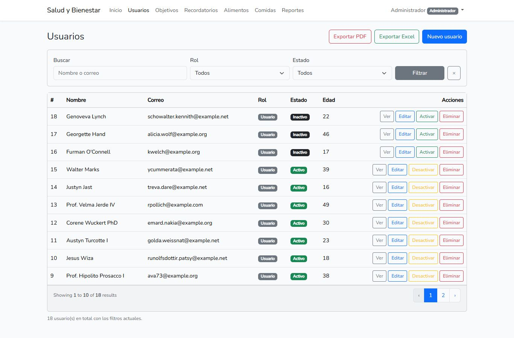

## 5. Ver el detalle de un usuario

Desde el listado, pulsa Ver. La ficha presenta correo, rol, estado y fecha de registro. El perfil muestra edad, sexo, altura, peso e IMC cuando existen los datos necesarios.

Usa Volver para regresar al listado. El botón Editar está disponible para administradores. Los datos visibles en este manual son ejemplos de desarrollo.

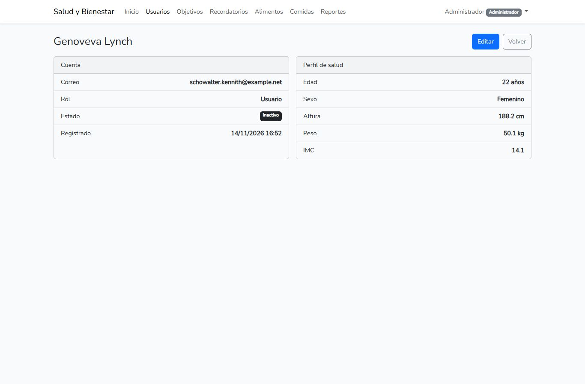

## 6. Crear un usuario

Como administrador, abre Usuarios y pulsa Nuevo usuario. Completa nombre, correo, contraseña y confirmación; selecciona el rol y el estado de la cuenta. El perfil de salud es opcional.

La contraseña necesita ocho o más caracteres, mayúscula, minúscula, número y símbolo. El correo no debe estar registrado. Los rangos del perfil son edad de 10 a 100 años, altura de 100 a 250 cm y peso de 20 a 300 kg.

Pulsa Crear usuario para guardar o Cancelar para salir del formulario. Si hay errores, corrige los campos señalados.

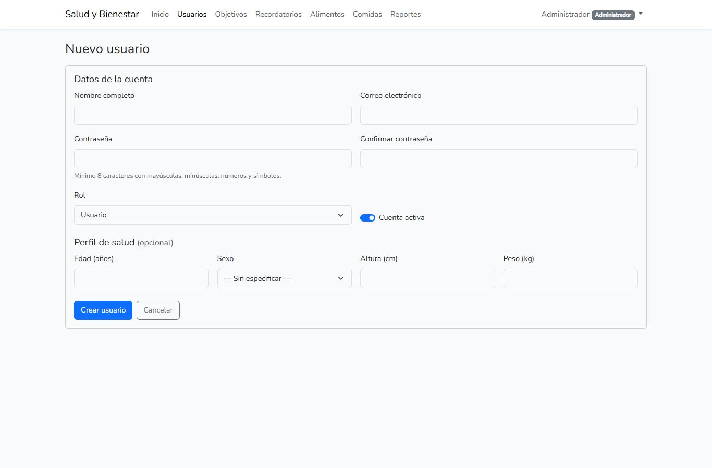

## 7. Editar, activar o eliminar usuarios

En el listado, pulsa Editar y actualiza los campos necesarios. Deja vacíos los campos de contraseña si deseas conservarla. Pulsa Guardar cambios.

Activar o Desactivar cambia el acceso de la cuenta. Al desactivarla o cambiar su contraseña se revocan sus tokens móviles. Eliminar requiere confirmar la acción en una ventana SweetAlert2.

El sistema impide eliminar o desactivar tu propia cuenta y dejar al sistema sin un administrador activo.

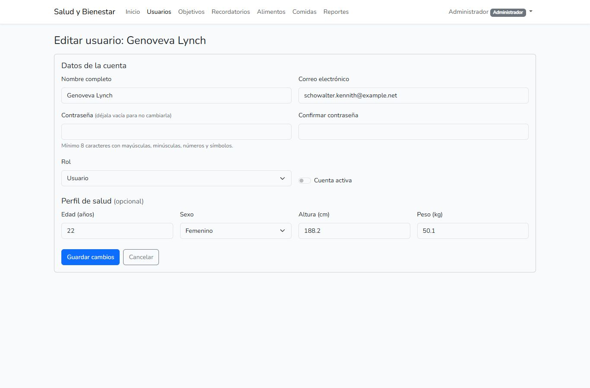

## 8. Consultar objetivos de salud

Abre Objetivos. Selecciona un usuario, estado o periodo de fecha límite y pulsa Filtrar. Limpiar restaura la consulta general.

Cada fila muestra el objetivo, su periodo, el avance y una barra de progreso. Cumplido significa que el valor actual alcanzó la meta. Vencido significa que pasó la fecha límite sin alcanzar la meta. Los demás aparecen En curso.

Los objetivos se crean y actualizan desde la aplicación móvil/API; esta pantalla permite consultarlos. Las metas representan cantidades acumuladas crecientes, como kilómetros, sesiones o días.

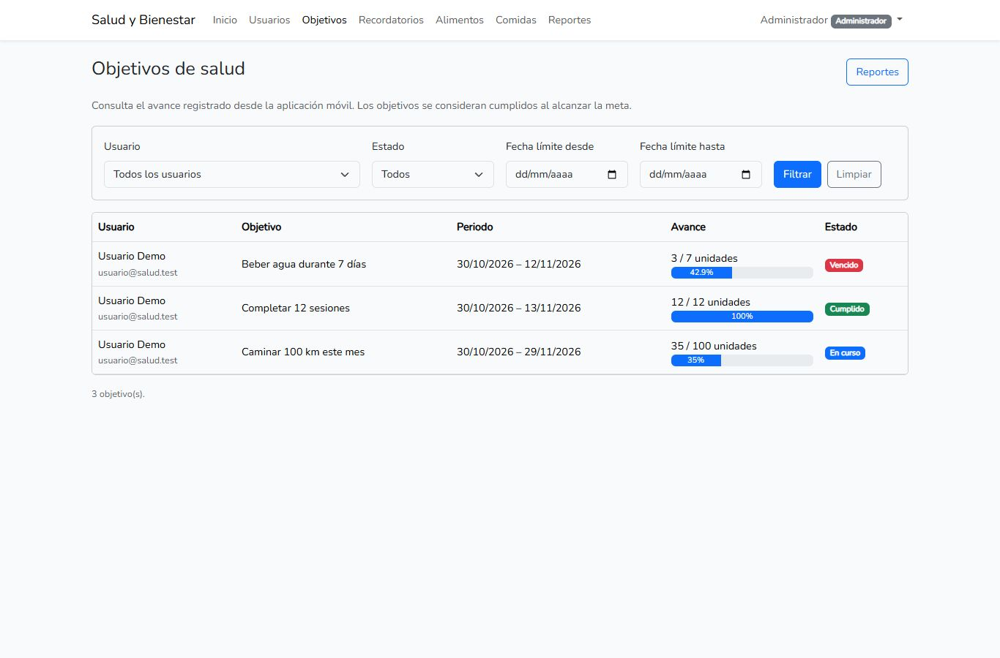

## 9. Consultar recordatorios

Abre Recordatorios y filtra por usuario, tipo o estado. Puedes consultar medicamentos y vitaminas con su dosis, hora, frecuencia y vigencia. Tomas registradas indica el número total de fechas marcadas como cumplidas.

Las frecuencias disponibles son diaria, semanal y mensual. Semanal repite el día de la semana de inicio; mensual usa el mismo día del mes o el último día si no existe. Cada recordatorio representa una toma por fecha programada.

La aplicación móvil gestiona los recordatorios y marca las tomas. El panel solo consulta. Este módulo no envía notificaciones ni determina dosis; los datos mostrados son de demostración.

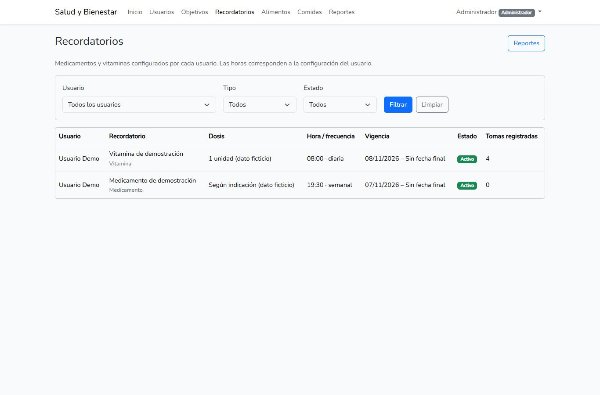

## 10. Consultar el catálogo de alimentos

Abre Alimentos. Escribe un nombre o selecciona una categoría y pulsa Filtrar. Limpiar muestra nuevamente el catálogo. Cada alimento indica el peso de una porción en gramos y las calorías de esa porción.

Los moderadores pueden consultar el catálogo. Los administradores disponen de Nuevo alimento, Editar y Eliminar. Las calorías de una comida se calculan multiplicando las porciones por las calorías de la porción guardada.

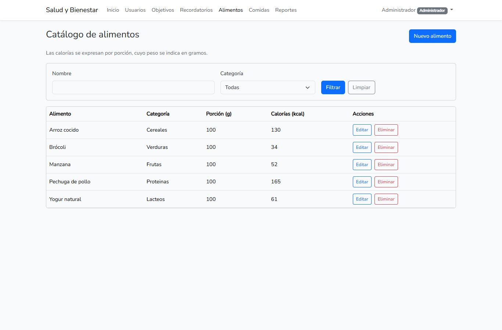

## 11. Crear un alimento

Pulsa Nuevo alimento, escribe un nombre único y selecciona la categoría. Indica el peso de la porción en gramos y sus calorías en kcal. El peso debe ser mayor que cero; las calorías pueden ser cero.

Pulsa Guardar alimento. El sistema vuelve al catálogo y muestra un mensaje de éxito. Si el nombre ya existe u otro campo es inválido, conserva los datos escritos y señala el error.

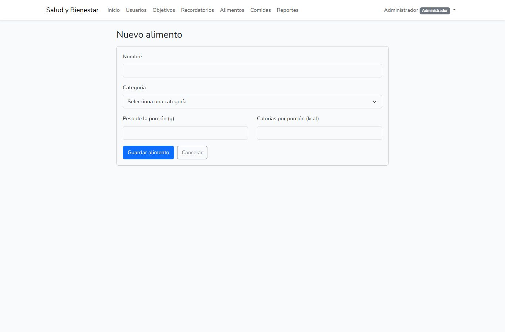

## 12. Editar y eliminar alimentos

En la fila del alimento, pulsa Editar, actualiza los datos y selecciona Guardar alimento. Cancelar regresa al catálogo.

Para eliminar un alimento, pulsa Eliminar y revisa el nombre en la confirmación. Cancelar conserva el registro. Sí, continuar ejecuta el borrado. No se puede eliminar un alimento incluido en un plan de comida.

Los cambios de calorías en el catálogo no recalculan los planes ya registrados; estos conservan las calorías que tenían al incorporar el alimento.

## 13. Consultar planes de comida

Abre Comidas y selecciona un usuario, una fecha o un tipo de comida. Pulsa Filtrar. Se admiten desayuno, almuerzo, cena y merienda.

Cada tarjeta muestra usuario, fecha, tipo, alimentos, número de porciones y calorías por alimento. Al final aparece el total en kcal y las notas del plan.

La aplicación móvil crea y modifica los planes. Solo se admite un plan por usuario, fecha y tipo de comida. El panel ofrece consulta y paginación.

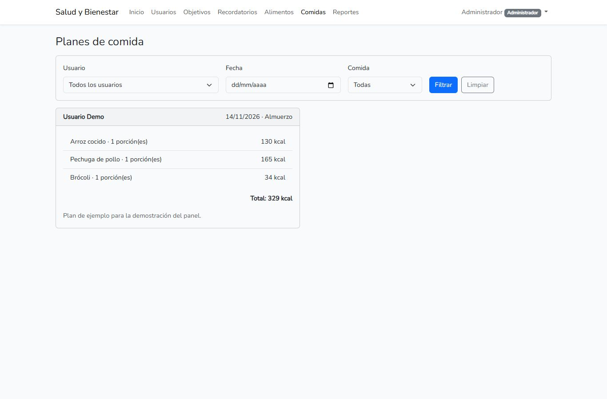

## 14. Descargar reportes de cumplimiento

Como administrador, abre Reportes. Elige el usuario o deja Todos y selecciona Desde y Hasta. El periodo debe estar ordenado y no superar 366 días. Pulsa Descargar PDF o Descargar Excel en el bloque correspondiente.

En objetivos puedes elegir el estado. El periodo filtra la fecha límite y el reporte muestra el avance actual. En recordatorios se comparan tomas registradas con fechas programadas hasta hoy, sin contar fechas futuras.

Los recordatorios pausados conservan sus tomas. El estado de pausa es actual y no existe historial de pausas: el reporte no descuenta pausas anteriores. Una toma es un registro realizado por el usuario, sin verificación clínica. Ambos formatos incluyen periodo, totales y porcentaje.

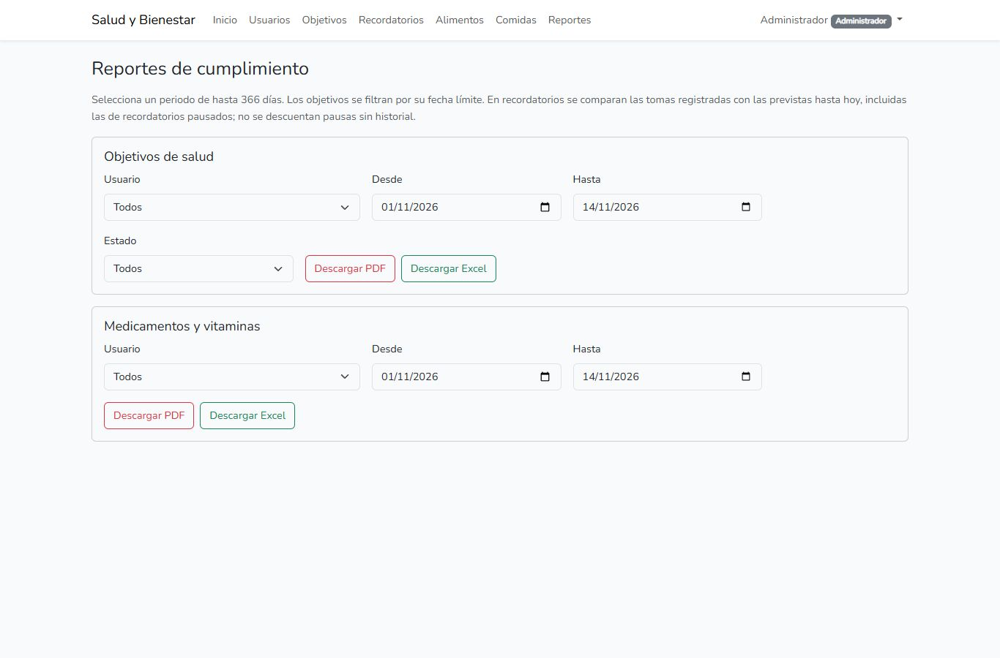

## 15. Mensajes de éxito y confirmaciones

Las operaciones correctas muestran una ventana con el resultado. Pulsa Aceptar para continuar. En una eliminación, lee el mensaje antes de decidir entre Cancelar y Sí, continuar.

Estas ventanas se usan en todo el panel, incluido el módulo de usuarios. Cancelar una confirmación no envía el formulario de eliminación.

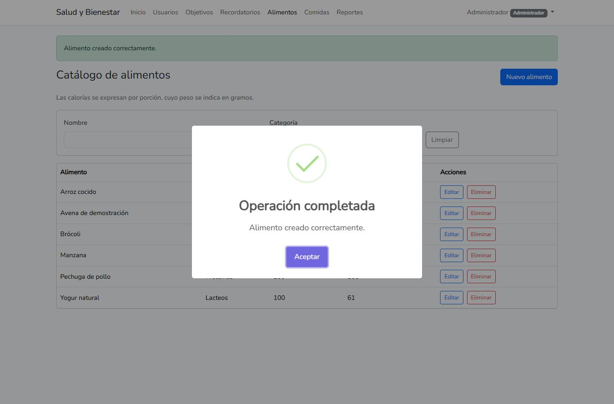

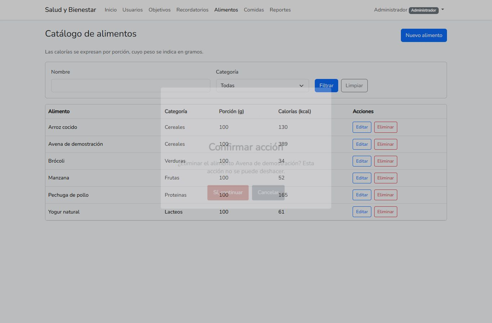

## 16. Errores y corrección de formularios

Una operación rechazada o un dato inválido muestra una alerta de error. Pulsa Aceptar y revisa los campos resaltados debajo del mensaje. Corrige el dato y vuelve a guardar.

La captura muestra un nombre de alimento repetido. También se validan fechas, valores numéricos y permisos. Si JavaScript no está disponible, el texto de los mensajes sigue visible en el panel.

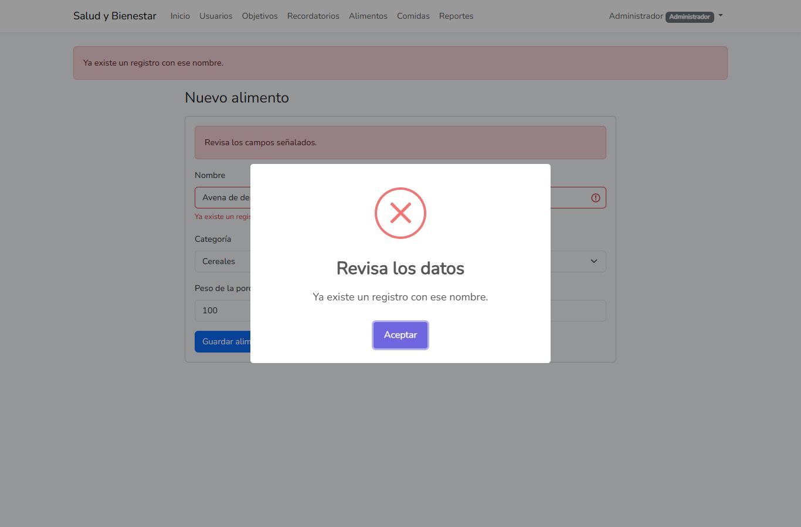

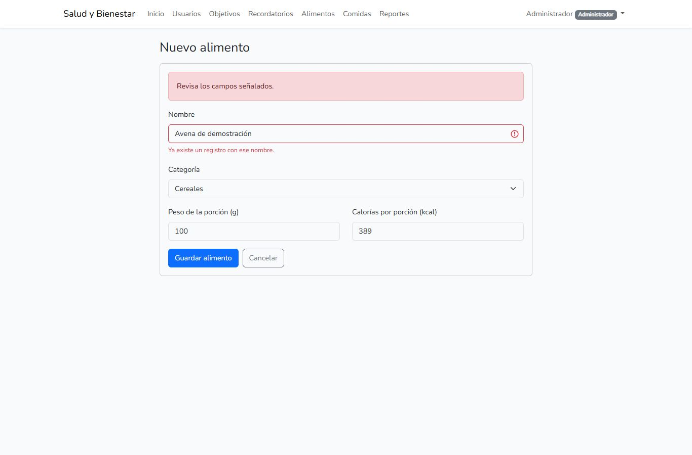

## 17. Uso desde una pantalla pequeña

El menú se agrupa en el botón de tres líneas. Los filtros se colocan uno debajo del otro. Las tablas mantienen el desplazamiento horizontal para consultar todas sus columnas.

La captura muestra Objetivos en una vista móvil. Para revisar el resto de la fila, desplaza la tabla horizontalmente. Los formularios y botones conservan las mismas funciones de la vista de escritorio.

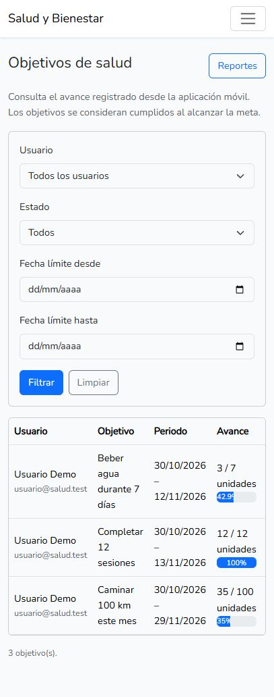
